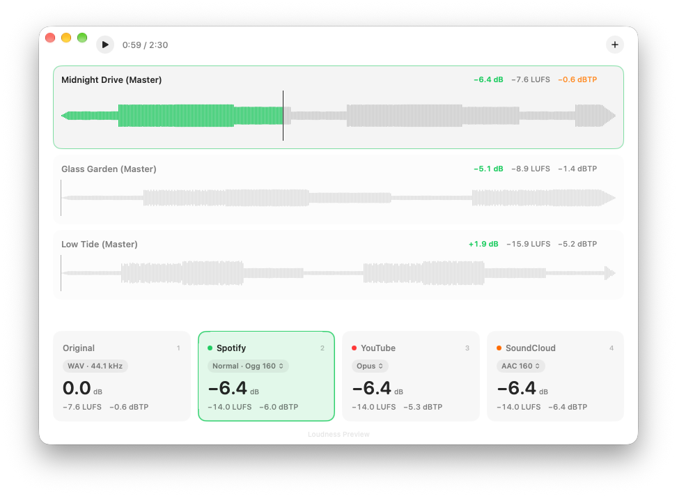

# Loudness Preview

Hear how your master will sound after Spotify, YouTube and SoundCloud apply loudness normalization and lossy encoding. Runs on macOS and Windows.



| Platform | Normalization | Codec |
|---|---|---|
| **Spotify** | Loud −11 / Normal −14 / Quiet −19 LUFS. Normal and Quiet raise quiet tracks only up to −1 dBTP; Loud raises them through a −1 dB limiter | Ogg Vorbis 96 / 160 / 320, Lossless |
| **YouTube** | −14 LUFS, turns loud tracks down only | Opus 128, AAC 128 |
| **SoundCloud** | −14 LUFS; quiet tracks are raised only up to −1 dBTP | AAC 160 (default), AAC 256 (Go+), Opus 64 (legacy) |

- Loudness follows ITU-R BS.1770-4 (integrated LUFS). True peak uses 4x oversampling.
- Every codec version is encoded and decoded with the real encoder libraries (libvorbis, libopus, AAC), so the readouts show true peak after decoding.
- You can load several songs and compare them. Click a song's waveform to switch to it and start playing from that point.

## Download

Get it from [Releases](../../releases).

**macOS** (15 or later, Apple Silicon): unzip `Loudness Preview-macOS.zip` and move the app to Applications. If macOS blocks it the first time you open it, run this:

```sh
xattr -cr "/Applications/Loudness Preview.app"
```

**Windows** (10/11, x64): unzip `Loudness Preview-win32-x64.zip` and run `Loudness Preview.exe`. If a SmartScreen warning appears, click **More info → Run anyway**.

## Shortcuts

| Key | Action |
|---|---|
| `1` `2` `3` `4` | Original / Spotify / YouTube / SoundCloud (press `2` again to cycle Normal → Loud → Quiet) |
| `Space` | Play / pause |
| `←` `→` | Seek ±5 s |
| `↑` `↓` | Switch song |
| `⌫` / `Delete` | Remove song |

## Build

- **macOS:** `./build.sh` → `build/Loudness Preview.app`. Needs only the Xcode Command Line Tools. AAC uses the macOS encoder.
- **Windows:** `Windows/build.sh` (run on macOS) → `Windows/dist/`. Needs Zig and Node.js. It's an Electron app; the audio core compiles the same C sources to WebAssembly, and AAC uses fdk-aac.

## Third-party

The original sources of libogg 1.3.5, libvorbis 1.3.7, libopus 1.5.2, speexdsp 1.2.1 (resampler) and fdk-aac 2.0.3 are in `Vendor/`. Each one's license is in its own folder.
